<p align="center">
  <picture>
    <source media="(prefers-color-scheme: dark)" srcset="docs/icon-dark.png">
    <source media="(prefers-color-scheme: light)" srcset="docs/icon-light.png">
    
  </picture>
</p>

# Cine

[](https://github.com/JKS-sys/cine-releases-11-Oct-2026/releases/latest)
[](https://github.com/JKS-sys/cine-releases-11-Oct-2026/releases)
  

**A tiny media player (under 5 MB) that plays almost anything and remembers every setting.**
By Jagadeesh Kumar S, creator — [youtube.com/@JKS-sys](https://www.youtube.com/@JKS-sys) · [ipconfig.co.network/cine](https://ipconfig.co.network/cine)

<p align="center">
   &nbsp; <br>
  <sub>Light icon · dark icon</sub>
</p>

## See it move
<a href="docs/media/startup.mp4"></a> <a href="docs/media/playback.mp4"></a>
<a href="docs/media/features.mp4"></a> <a href="docs/media/owner.mp4"></a>

## Screenshots
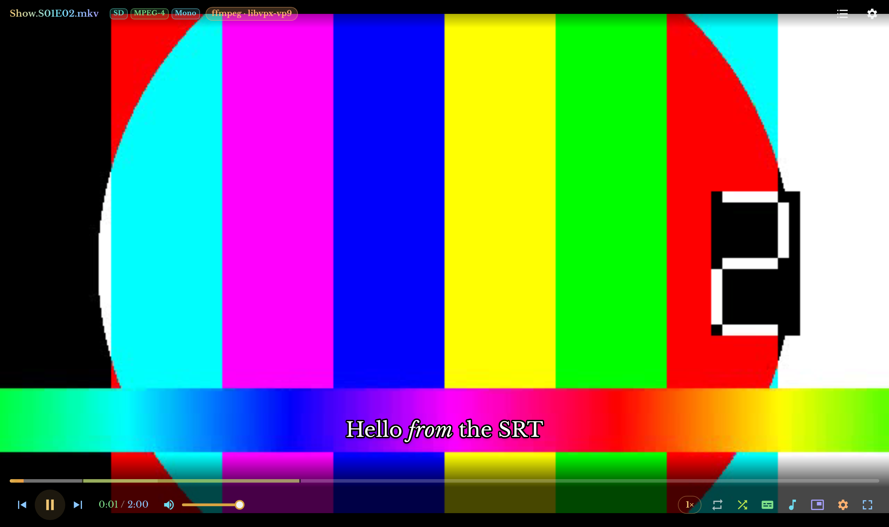 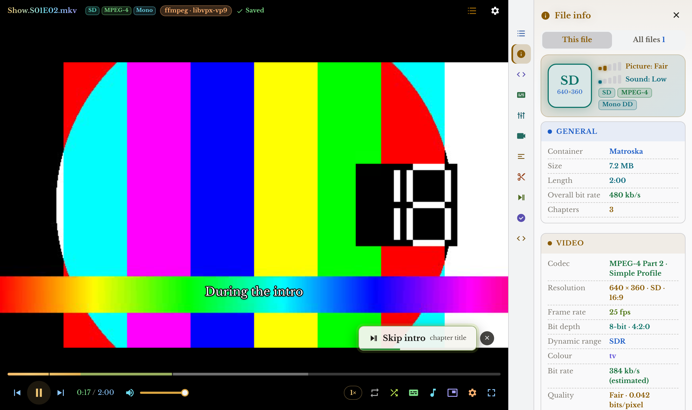
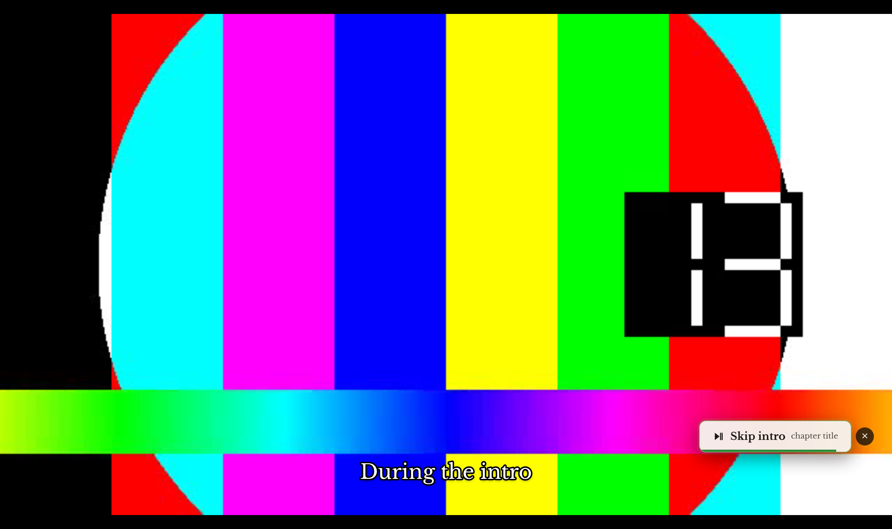 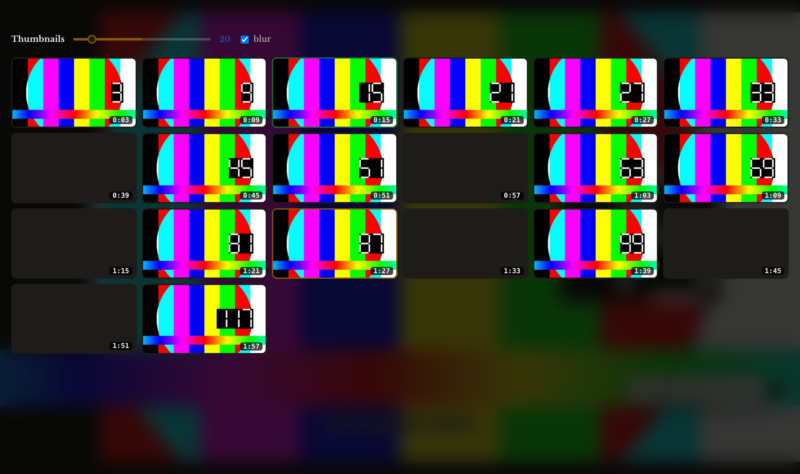
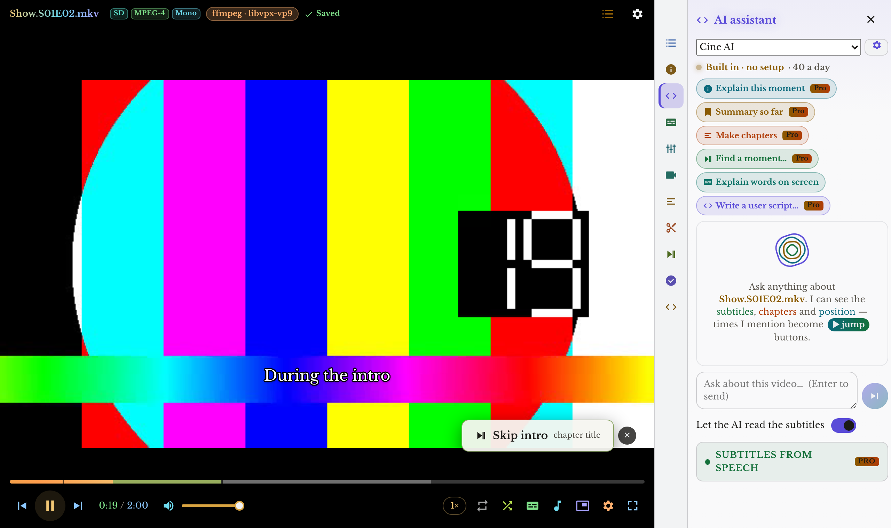 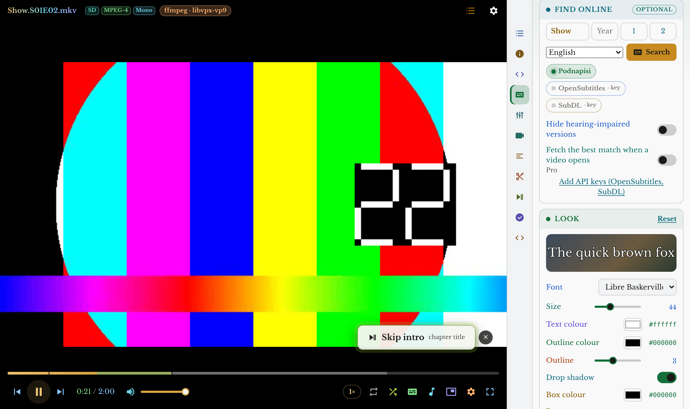
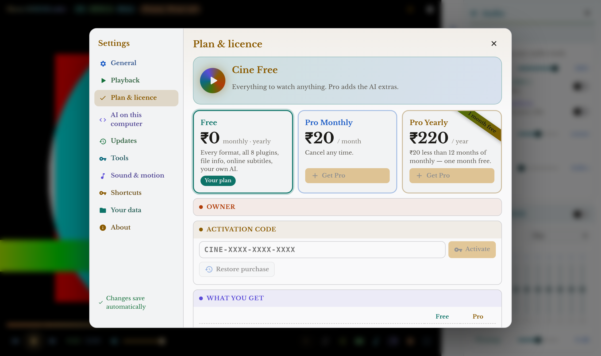 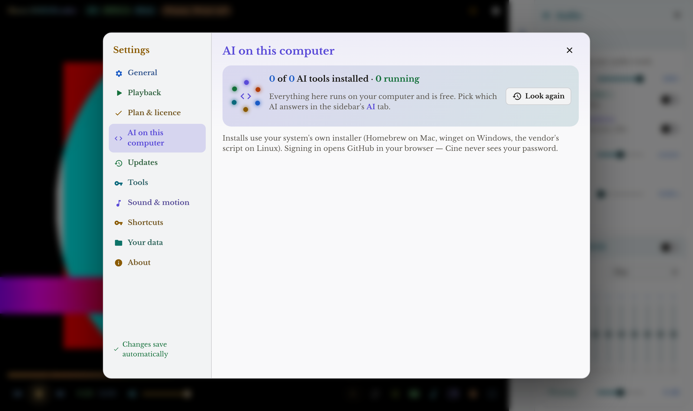
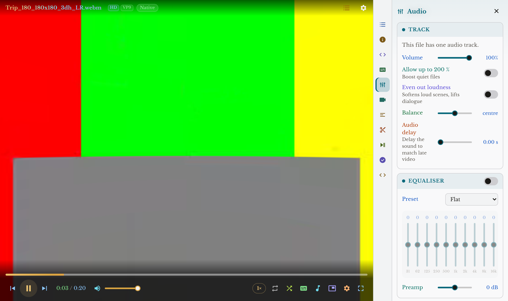 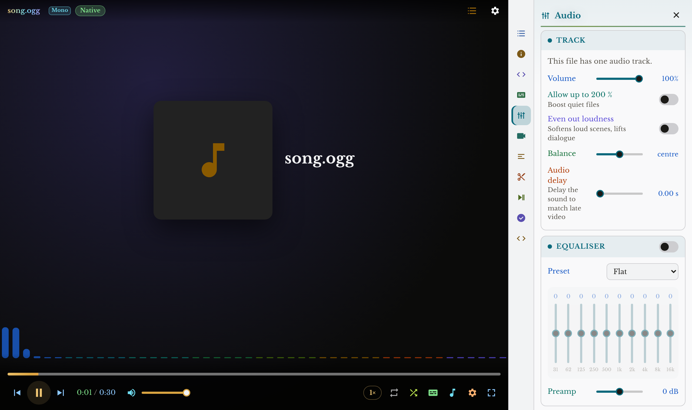
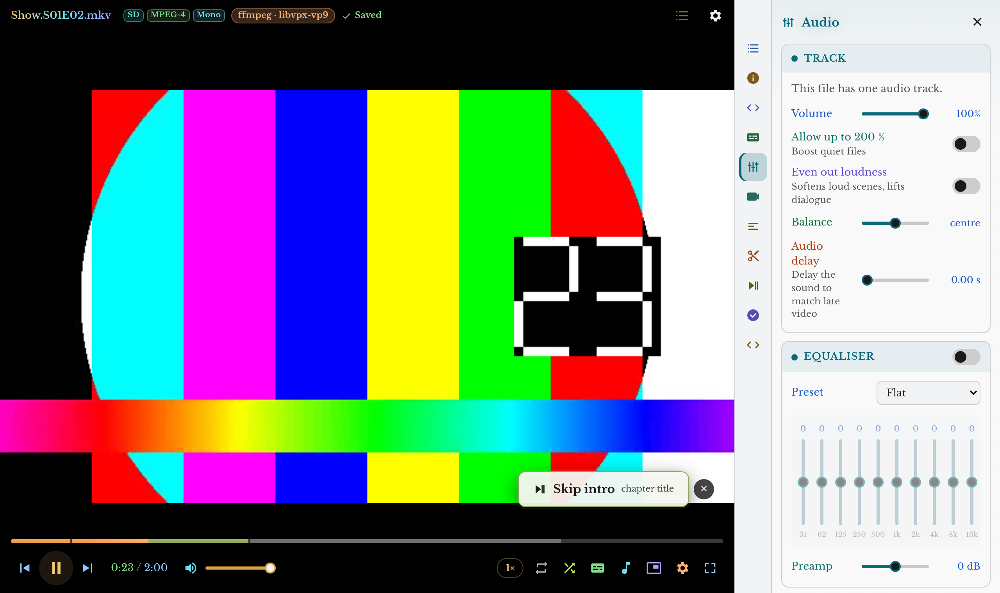 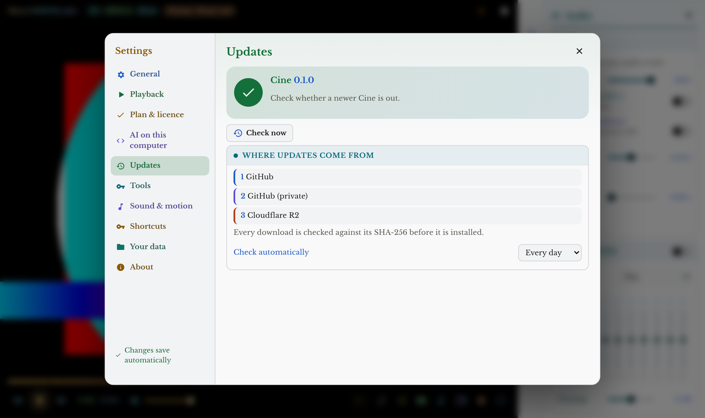
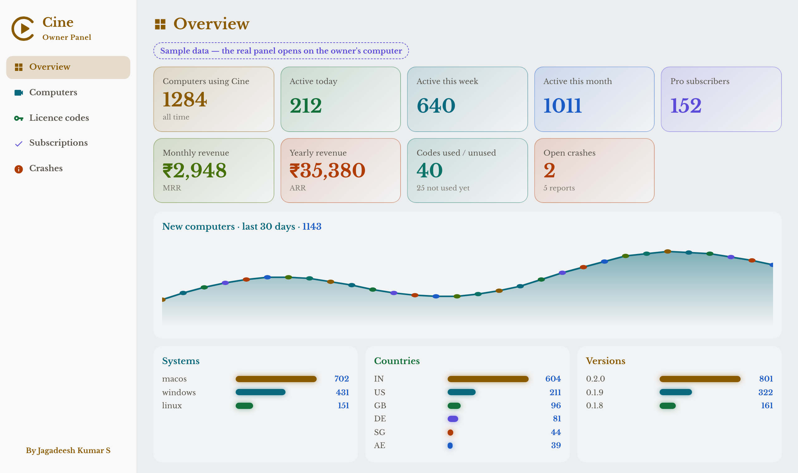 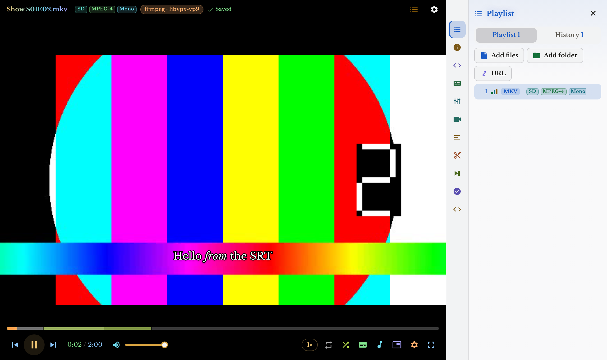

## What it does
- **Every format** — the system decodes what it can; everything else (MKV, AVI, WMV, FLV, AC-3, DTS…) streams through ffmpeg, copied when possible, converted when needed.
- **Settings that save themselves** — repeat (off / this file / playlist / once then stop), subtitle font, size, colours, outline and position, volume, equaliser, speed and every plugin option are written to disk as you change them and restored next launch. Each file remembers its position, tracks, subtitle delay and VR view.
- **Thumbnails** — previews on the seek bar and a clickable grid of 10–100 frames.
- **Skip Intro** — from chapter titles, chapter timing, audio fingerprints shared across episodes, or marks you set once per series.
- **Recorder** — save a clip (MP4, MOV, GIF, M4A, MP3), with a 9:16 crop for Shorts and Reels.
- **Bilingual subtitles** — a second subtitle track, or an AI translation from a local model (Ollama, LM Studio) or any OpenAI-compatible service.
- **Trakt** — scrobbles movies and episodes as you watch.
- **User scripts** — automate the player with JavaScript through the built-in `cine` scripting API.
- **VR → 2D** — 180°/360°, side-by-side or over-under, equirectangular, fisheye or cubemap, flattened so you can look around with the mouse.
- **File info for every file** — resolution class (SD to 8K), HDR10 / HLG / Dolby Vision, codec, bit depth, frame rate, bit rates, audio layout, sample rate, lossless / Hi-Res, and a plain-words grade for picture and sound — for the playing file and every file in the playlist.
- **Repeat modes** — off, this file, the whole playlist, or **play one file once, then stop** even with more files queued.
- **Online subtitles (optional)** — search Podnapisi, OpenSubtitles and SubDL from inside the app; exact file-hash matches first; downloaded, unzipped and switched on in one click.
- **AI** — Cine AI built in, GitHub Copilot through its CLI (sign in through the browser), GitHub Models, or any AI already on your computer (Ollama, LM Studio, Jan, llama.cpp, LocalAI, GPT4All…). Explain this moment, summary so far, make chapters, find a moment, explain words, write user scripts, subtitles from speech with Whisper. Times in answers become jump buttons.
- **Manage AI on this computer** — find, install, start, stop, uninstall, download and remove models, and sign in to Copilot / GitHub.
- **Updates** — checks GitHub first, then a private GitHub mirror, then Cloudflare R2; every download is checked against its SHA-256.
- Equaliser with presets, volume to 200 %, A-B loop, bookmarks, chapters, picture-in-picture, screenshots, playlists, history, music mode.

## Plans
| | Free | Pro |
|---|---|---|
| Price | **₹0** monthly · yearly | **₹20 a month** or **₹220 a year** (one month free) |
| Every format, all 8 plugins, file info, online subtitles, your own AI | ✓ | ✓ |
| Cine AI built in | 40 a day | 400 a day |
| AI tools, subtitles from speech, AI translation with Cine AI, automatic subtitles, CSV export | — | ✓ |

Pay with Razorpay (UPI, cards, net banking) in Settings → Plan & licence, or type an activation code.

## Install
| | |
|---|---|
| macOS (Apple silicon) | [Cine_0.1.10_aarch64.dmg](https://github.com/JKS-sys/cine-releases-11-Oct-2026/releases/download/v0.1.10/Cine_0.1.10_aarch64.dmg) |
| macOS (Intel) | [Cine_0.1.10_x64.dmg](https://github.com/JKS-sys/cine-releases-11-Oct-2026/releases/download/v0.1.10/Cine_0.1.10_x64.dmg) |
| Windows, Linux | on the [release page](https://github.com/JKS-sys/cine-releases-11-Oct-2026/releases/latest) |

```sh
# macOS, one line
curl -fsSL https://github.com/JKS-sys/cine-releases-11-Oct-2026/releases/download/v0.1.10/Cine_0.1.10_$(uname -m | sed -e s/arm64/aarch64/ -e s/x86_64/x64/).dmg -o /tmp/Cine.dmg && hdiutil attach -quiet /tmp/Cine.dmg && cp -R /Volumes/Cine/Cine.app /Applications/ && hdiutil detach -quiet /Volumes/Cine && xattr -cr /Applications/Cine.app
```

```sh
# Homebrew, no tap needed
curl -fsSLO https://raw.githubusercontent.com/JKS-sys/cine-releases-11-Oct-2026/main/cine.rb && brew install --cask ./cine.rb
```

For the widest format support also install ffmpeg: `brew install ffmpeg` · `winget install Gyan.FFmpeg` · `sudo apt install ffmpeg`.

## Release notes
See the [releases](https://github.com/JKS-sys/cine-releases-11-Oct-2026/releases).

© Jagadeesh Kumar S. All rights reserved.
